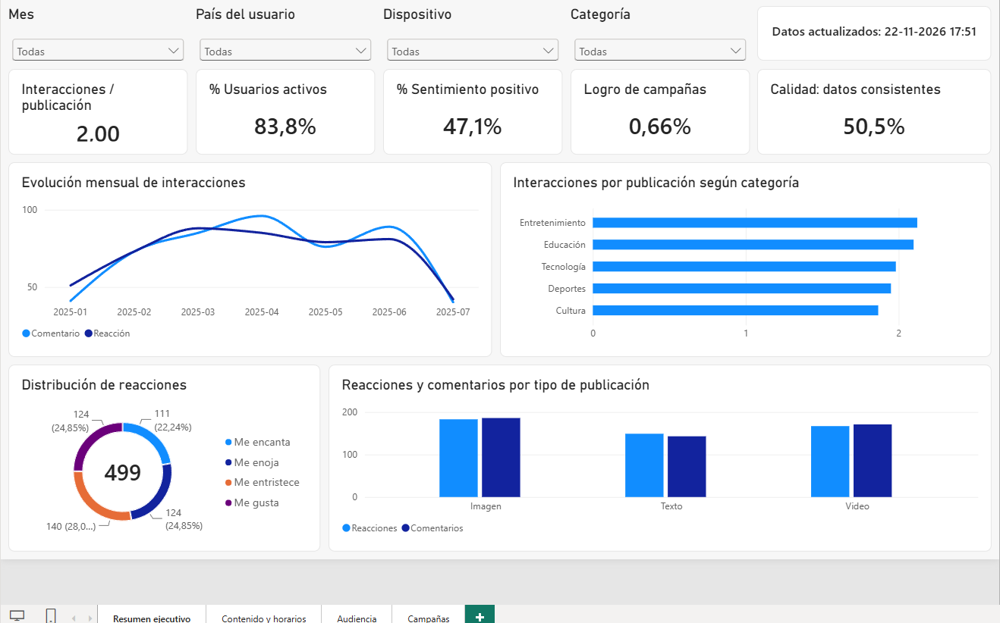
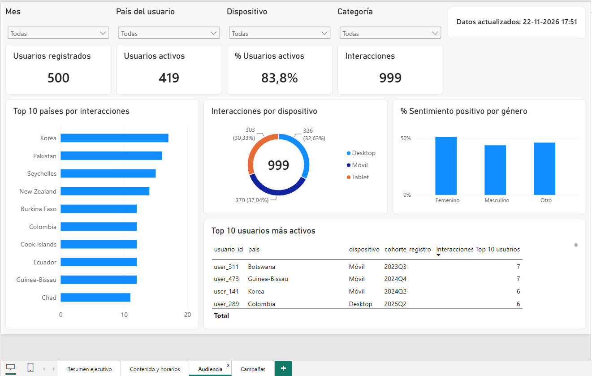
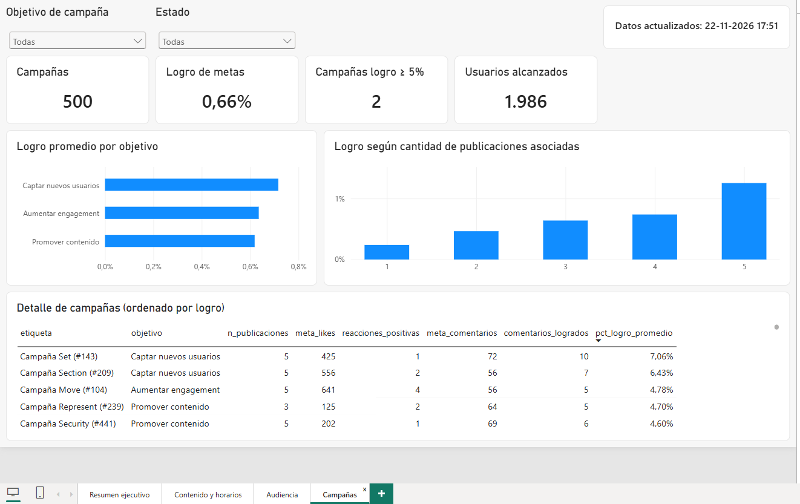

# ContentFlow — Explotación de datos NoSQL para el análisis organizacional

Evaluación Parcial N°3 · BDY0101 Base de Datos No Relacionales · Duoc UC · Caso Forma A

Pipeline de datos que extrae la base documental de **ContentFlow** desde **Azure Cosmos DB (API para MongoDB)**, la transforma con **Python (PyMongo + pandas)** en un modelo estrella y la presenta en un tablero interactivo de **Power BI** con 4 KPIs.

📄 **Informe técnico:** [`docs/informe/Informe_ContentFlow.pdf`](docs/informe/Informe_ContentFlow.pdf)

```
Azure Cosmos DB (API MongoDB 4.2)  ──►  etl_contentflow.py  ──►  data/processed/*.csv  ──►  Power BI (.pbip)
5 colecciones · 2.500 documentos       $lookup $unwind $group     modelo estrella             4 páginas · 26 medidas DAX
                                        + 21 transformaciones       + bitácora                  4 KPIs + calidad de datos
```

## KPIs

| KPI | Cálculo | Valor |
|---|---|---|
| Interacciones por publicación | interacciones / publicaciones | 2,00 |
| % usuarios activos | usuarios con ≥1 interacción / usuarios registrados | 83,8 % |
| % sentimiento positivo | (Me gusta + Me encanta) / reacciones | 47,1 % |
| Logro de campañas | promedio de logro de metas de likes y comentarios | 0,66 % |
| Calidad de datos | interacciones con fecha posterior a su publicación | 50,5 % |

## Tablero

| Resumen ejecutivo | Contenido y horarios |
|---|---|
|  |  |
| **Audiencia** | **Campañas** |
|  |  |

## Estructura

```
data/raw/                 JSON del anexo (datos simulados del caso)
data/processed/           tablas del modelo + bitacora_transformaciones.csv
scripts/
  cargar_datos.py         carga inicial de los JSON a Cosmos DB
  etl_contentflow.py      extracción (6 consultas) + transformación + carga
  generar_pbip.py         genera el modelo (TMDL) y el informe (PBIR) de Power BI
  actualizar.ps1          ejecuta el ETL y registra en logs/
  registrar_tarea.ps1     (opcional) programa actualizar.ps1 en Windows
  preparar_equipo.ps1     deja listo cualquier computador en un paso
  demo_en_vivo.py         inserta / revierte datos para demostrar la actualización
  construir_informe.py    genera el informe HTML y PDF
powerbi/ContentFlow.pbip  proyecto Power BI (abrir con Power BI Desktop)
docs/                     informe y capturas
```

## Cómo ejecutarlo

Requisitos: Python 3.10+, Power BI Desktop y acceso a la cuenta de Cosmos DB.

1. Crear `.env` en la raíz a partir de [`.env.example`](.env.example) con la cadena de conexión de Cosmos DB. **No se sube al repositorio.**
2. Preparar el equipo (entorno virtual, prueba de conexión, ETL y ruta de datos de Power BI):
   ```powershell
   powershell -ExecutionPolicy Bypass -File scripts\preparar_equipo.ps1
   ```
3. Abrir `powerbi\ContentFlow.pbip` y pulsar **Actualizar**.

Actualizaciones posteriores: `powershell -File scripts\actualizar.ps1` y luego **Actualizar** en Power BI.

### Demo de actualización

```powershell
.\.venv\Scripts\python.exe scripts\demo_en_vivo.py insertar   # +60 reacciones y +20 comentarios en Cosmos DB
powershell -File scripts\actualizar.ps1                         # ETL
# Power BI > Actualizar  →  interacciones 999 → 1.079
.\.venv\Scripts\python.exe scripts\demo_en_vivo.py revertir   # deja la base como estaba
```

## Notas técnicas

- Se usa **PyMongo 4.10.1** porque las versiones posteriores no admiten servidores MongoDB 4.2 (versión de la cuenta Cosmos DB).
- El 49,5 % de las interacciones del anexo tiene fecha anterior a su publicación: se marcan con `consistente_temporal` en vez de eliminarse (ver informe, sección 5).
- El ETL no extrae nombres de usuario y descarta el correo tras obtener su dominio.
